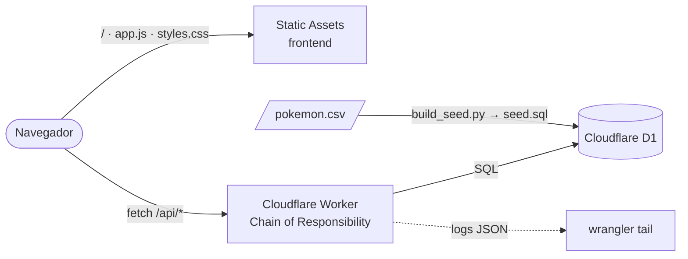

<div align="center">

# ⚡ Pokédex Serverless

### *Cloudflare Workers + D1 · Integración de datos con computación serverless*

**Módulo: Contenerización de Aplicaciones de Software · Politécnico Grancolombiano · Unidad 4**


[](LICENSE)

**[Contexto](#-contexto-y-alcance) • [Contenido](#-contenido-del-repositorio) • [Tecnologías](#-tecnologías-utilizadas) • [Arquitectura](#️-arquitectura) • [API](#-endpoints-de-la-api) • [Ejecución](#-ejecución) • [Problemas](#️-solución-de-problemas) • [Autor](#-autor)**


</div>

---

## 📋 Tabla de Contenidos

- [🎯 Contexto y Alcance](#-contexto-y-alcance)
- [🎬 Video Explicativo](#-video-explicativo)
- [📁 Contenido del Repositorio](#-contenido-del-repositorio)
- [🧰 Tecnologías Utilizadas](#-tecnologías-utilizadas)
- [🏗️ Arquitectura](#️-arquitectura)
- [🧩 Patrones Aplicados](#-patrones-aplicados)
- [🔌 Endpoints de la API](#-endpoints-de-la-api)
- [🚀 Ejecución](#-ejecución)
- [🧪 Pruebas](#-pruebas)
- [📡 Logs y Eliminación de Recursos](#-logs-y-eliminación-de-recursos)
- [🛠️ Solución de Problemas](#️-solución-de-problemas)
- [📝 Nota](#-nota)
- [⚖️ Licencia](#️-licencia)
- [👤 Autor](#-autor)

---

## 🎯 Contexto y Alcance

Este repositorio implementa un flujo completo de **integración de datos con computación serverless** para la **Actividad Sumativa de la Unidad 4** (*Creación de aplicación usando el patrón serverless*) de la Maestría en Arquitectura de Software.

No hay servidores que aprovisionar, parchear ni escalar. Funciona en el plan gratuito de Cloudflare, **sin tarjeta de crédito**; si se supera el límite diario gratuito, las consultas fallan en lugar de generar cobros.

> **Dataset:** CSV público de Pokémon con **1.215 registros** y **13 columnas**.
> **Base de datos:** Cloudflare D1 (SQL sobre SQLite), totalmente serverless.
> **Flujo:** CSV → `build_seed.py` → `seed.sql` → D1 → Worker (`/api/*`) → aplicación web.

### 🌟 ¿Qué incluye el proyecto?

- 📥 **Carga de datos** desde el CSV con inferencia de tipos, limpieza de vacíos, resolución de colisiones y validación de claves.
- 🗄️ **Base de datos serverless** con clave primaria compuesta `(id, form)` e índices por tipo y generación.
- ⚙️ **Worker** (función serverless) que expone una API REST con el patrón *Chain of Responsibility*.
- 🔍 **Búsqueda por ID** (clave principal) y **por nombre** (columna secundaria), con filtros y paginación por cursor.
- 🖥️ **Aplicación web** con tabla, ficha en tarjeta y gráficas.
- 🧪 **23 pruebas automáticas**: 17 del Worker sobre SQLite real y 6 del generador de SQL.

---

## 🎬 Video Explicativo

📺 **[Ver el video explicativo de la actividad en YouTube](https://youtu.be/TodbzdBe8oU)**

> ⚠️ **Calidad:** el video debe verse en **1080p HD** (en YouTube: engranaje → Calidad → 1080p); en calidades inferiores el texto del código y de las terminales no se lee correctamente.

---

## 📁 Contenido del Repositorio

<table align="center">
  <tr><th>Elemento</th><th>Descripción</th></tr>
  <tr><td colspan="2"><b>📂 db/</b></td></tr>
  <tr><td><code>schema.sql</code></td><td>🧱 <b>Script de base de datos</b>: tabla <code>pokemon</code> con clave <code>(id, form)</code> e índices por tipo y generación</td></tr>
  <tr><td><code>seed.sql</code></td><td>📥 Datos: 1.215 sentencias <code>INSERT OR REPLACE</code> generadas desde el CSV</td></tr>
  <tr><td colspan="2"><b>📂 data/</b></td></tr>
  <tr><td><code>pokemon.csv</code></td><td>📋 Dataset original</td></tr>
  <tr><td colspan="2"><b>📂 scripts/</b></td></tr>
  <tr><td><code>build_seed.py</code></td><td>🔄 Convierte el CSV en <code>seed.sql</code>: infiere tipos, limpia vacíos, resuelve colisiones y valida claves</td></tr>
  <tr><td><code>deploy.sh</code></td><td>🚀 Despliegue completo en un comando</td></tr>
  <tr><td><code>destroy.sh</code></td><td>🧹 Elimina el Worker y la base de datos</td></tr>
  <tr><td colspan="2"><b>📂 src/</b></td></tr>
  <tr><td><code>worker.js</code></td><td>⚙️ Punto de entrada del Worker</td></tr>
  <tr><td><code>chain.js</code></td><td>🔗 Manejadores del patrón <i>Chain of Responsibility</i> (rutas de la API)</td></tr>
  <tr><td><code>repository.js</code></td><td>🗄️ Consultas SQL a D1, paginación por cursor y estadísticas</td></tr>
  <tr><td colspan="2"><b>📂 frontend/</b></td></tr>
  <tr><td><code>index.html</code> · <code>styles.css</code> · <code>app.js</code> · <code>config.js</code></td><td>🖥️ Aplicación web servida como archivos estáticos</td></tr>
  <tr><td colspan="2"><b>📂 tests/</b></td></tr>
  <tr><td><code>worker.test.mjs</code> · <code>d1-shim.mjs</code></td><td>🧪 17 pruebas del Worker sobre SQLite real</td></tr>
  <tr><td><code>test_seed.py</code></td><td>🧪 6 pruebas del generador de SQL</td></tr>
  <tr><td colspan="2"><b>📂 docs/</b></td></tr>
  <tr><td><code>Desarrollo_U4_Actividad_Sumativa_Serverless.pdf</code></td><td>📑 Documento de entrega de la actividad (PDF)</td></tr>
  <tr><td colspan="2"><b>📂 raíz</b></td></tr>
  <tr><td><code>wrangler.toml</code></td><td>☁️ Configuración de Cloudflare (Worker, archivos estáticos y enlace a D1)</td></tr>
  <tr><td><code>package.json</code> · <code>package-lock.json</code></td><td>📦 Dependencias y comandos de Node (<code>dev</code>, <code>db:local</code>, <code>test</code>, <code>deploy</code>)</td></tr>
  <tr><td><code>requirements-dev.txt</code></td><td>🐍 Dependencias de Python para las pruebas</td></tr>
  <tr><td><code>.gitignore</code></td><td>🚫 Excluye <code>node_modules/</code>, <code>.wrangler/</code>, cachés de Python y <code>.dev.vars</code></td></tr>
  <tr><td><code>README.md</code></td><td>📄 Este documento</td></tr>
  <tr><td><code>LICENSE</code></td><td>⚖️ Licencia MIT</td></tr>
</table>

---

## 🧰 Tecnologías Utilizadas

<div align="center">


</div>

| Componente | Uso |
|:---|:---|
| **Cloudflare Workers** | Función serverless que atiende las rutas `/api/*` |
| **Cloudflare D1** | Base de datos SQL serverless (SQLite) con los 1.215 registros |
| **Static Assets** | Sirve el frontend (`frontend/`) directamente desde Cloudflare |
| **Wrangler** | CLI para desarrollo local, carga de datos, despliegue y logs |
| **Python** | Generación de `seed.sql` a partir del CSV y sus pruebas con pytest |
| **Node.js (`node --test`)** | Pruebas del Worker sobre SQLite real |
| **Mermaid** | Diagrama de arquitectura de este README |

---

## 🏗️ Arquitectura



| Aspecto | Decisión |
|:---|:---|
| 🔑 **Clave primaria** | La columna `ID` del CSV se repite en 153 especies con formas alternas (Mega, Alola, Galar…), por lo que la clave es **compuesta**: `(id, form)` |
| 📇 **Índices secundarios** | Dos índices resuelven los filtros por **tipo** y por **generación** |
| 📄 **Paginación** | **Cursor por clave** (sin `OFFSET`), con orden global por `(id, form)` |
| 🌐 **Enrutamiento** | Solo `/api/*` ejecuta el Worker; el resto lo sirve Static Assets |

---

## 🧩 Patrones Aplicados

| Patrón | Dónde |
|:---|:---|
| ☁️ **Despliegue de microservicios serverless** | El Worker se ejecuta por petición, escala solo y no requiere servidor |
| 🔗 **Chain of Responsibility** | `chain.js`: `MethodGuard → Health → ById → List → Stats → 404` |

---

## 🔌 Endpoints de la API

| Método y ruta | Descripción |
|:---|:---|
| `GET /api/health` | 💚 Estado del servicio |
| `GET /api/pokemon/{id}` | 🔍 Todas las formas de una especie (búsqueda por ID) |
| `GET /api/pokemon?name=pika` | 🔤 Búsqueda parcial por nombre, sin distinguir mayúsculas |
| `GET /api/pokemon?type=Fire&generation=1&limit=25&cursor=…` | 🎛️ Listado filtrado y paginado |
| `GET /api/stats` | 📊 Agregados para las gráficas |

---

## 🚀 Ejecución

Requisitos: **Node.js 18 o superior**. Para las pruebas de Python: `pip install -r requirements-dev.txt`.

### 💻 Opción A · Local (sin cuenta)

```bash
npm install
npm run db:local        # crea el esquema y carga los 1.215 registros en una D1 local
npm run dev             # abre http://localhost:8787
```

### ☁️ Pasos manuales (recomendado, verificados)

```bash
# 1. Instala wrangler y las dependencias del proyecto
npm install

# 2. Inicia sesión en Cloudflare (abre el navegador; plan gratuito, sin tarjeta)
npx wrangler login

# 3. Crea la base D1 → copia el database_id que imprime a wrangler.toml
npx wrangler d1 create pokedex

# 4. Crea la tabla y los índices en la base remota
npx wrangler d1 execute pokedex --remote --file db/schema.sql

# 5. Carga los 1.215 registros
npx wrangler d1 execute pokedex --remote --file db/seed.sql

# 6. Verifica la carga (esperado: filas = 1215, ids = 1025)
npx wrangler d1 execute pokedex --remote --command "SELECT COUNT(*) AS filas, COUNT(DISTINCT id) AS ids FROM pokemon"

# 7. Publica el Worker y el frontend
npx wrangler deploy
```

Al terminar, `wrangler` imprime la URL pública (`https://pokedex-serverless.<tu-subdominio>.workers.dev`).

### ⚡ Atajo con script (Mac/Linux)

```bash
./scripts/deploy.sh     # automatiza los mismos pasos: sesión, D1, esquema, datos, verificación y despliegue
```

> ℹ️ Este script automatiza los mismos pasos, pero no fue probado de extremo a extremo; si falla, usa los pasos manuales anteriores.

---

## 🧪 Pruebas

```bash
npm test                # 17 pruebas del Worker + 6 del generador de SQL
```

<details>
<summary><b>🔎 Ver qué cubre cada grupo de pruebas</b></summary>

| Grupo | Archivo | Cantidad |
|:---|:---|:---:|
| Worker sobre SQLite real: carga de datos, health, búsqueda por ID y por nombre, filtros, paginación por cursor, validaciones, estadísticas, CORS y esquema | `tests/worker.test.mjs` | 17 |
| Generador de SQL a partir del CSV | `tests/test_seed.py` | 6 |

</details>

---

## 📡 Logs y Eliminación de Recursos

```bash
npx wrangler tail       # una línea JSON por petición
./scripts/destroy.sh    # elimina el Worker y la base D1 (pide confirmación)
```

---

## 🛠️ Solución de Problemas

- **Rutas con tildes o espacios en Windows** → si `npm run db:local` o `npm run dev` fallan con `internal error`, mueve el proyecto a una carpeta con ruta simple (por ejemplo `C:\dev\pokedex-serverless`). El motor local de wrangler no abre la base de datos en rutas con caracteres como "í".
- **Primer acceso tras desplegar** → la URL pública puede tardar unos 2 minutos en responder mientras Cloudflare prepara el certificado del subdominio nuevo.
- **`npm test` falla en la parte de Python** → instala pytest con `pip install -r requirements-dev.txt` y verifica a qué Python apunta el comando `python3`.

---

## 📝 Nota

Este proyecto corresponde a una **actividad académica** y se elaboró con fines exclusivamente formativos.

<sub>Datos: lista pública de Pokémon (GitHub · lgreski/pokemonData). Pokémon y sus nombres son marcas de sus respectivos propietarios; uso estrictamente académico.</sub>

---

## ⚖️ Licencia

Este proyecto se distribuye bajo la **Licencia MIT**. Consulta el archivo [`LICENSE`](LICENSE) para más detalles.

---

## 👤 Autor

<div align="center">

Este proyecto fue desarrollado en el marco del módulo **Contenerización de Aplicaciones de Software** de la **Maestría en Arquitectura de Software** del **Politécnico Grancolombiano**, bajo la orientación del docente **Victor Augusto Pedraza Bonilla**.

| Autor | Perfil |
|:---:|:---:|
| ***Alejandro De Mendoza*** | [](https://github.com/AlejoTechEngineer) |

</div>

---

<div align="center">

### ⚡ *Sin servidores que administrar, solo código que responde*

**Contenerización de Aplicaciones de Software · Pokédex Serverless – Cloudflare Workers + D1**

</div>
